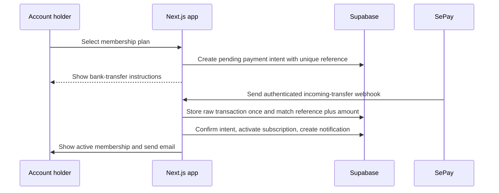

# Infrastructure and Integration Contracts

## System of Record

| Concern | Standard service | Responsibility |
| --- | --- | --- |
| Source code and review history | GitHub | Main branch protection, pull requests and quality checks |
| Web application and environments | Vercel | Preview deployments, production deployment, logs and environment variables |
| Identity, database, storage and realtime | Supabase | Auth, Postgres, Storage and Row Level Security |
| Membership bank-transfer confirmation | SePay | Receives payment data and sends a signed webhook to the application |
| Transactional email | Resend | Sends account, inquiry and operational emails from a verified domain |

## Environment Variable Contract

Use the same variable names in local, Vercel Preview and Vercel Production. Values are stored only in local untracked environment files or the Vercel dashboard.

| Variable | Visibility | Purpose |
| --- | --- | --- |
| `NEXT_PUBLIC_APP_URL` | Browser | Canonical public URL |
| `NEXT_PUBLIC_SUPABASE_URL` | Browser | Supabase project URL |
| `NEXT_PUBLIC_SUPABASE_PUBLISHABLE_KEY` | Browser | Supabase browser-safe key |
| `SUPABASE_SERVICE_ROLE_KEY` | Server only | Privileged operational tasks; never browser code |
| `SEPAY_WEBHOOK_SECRET` | Server only | Validates incoming payment webhooks |
| `SEPAY_ACCOUNT_NUMBER` | Server only | Receiving account used to generate membership instructions |
| `SEPAY_BANK_CODE` | Server only | Bank metadata for payment instructions |
| `RESEND_API_KEY` | Server only | Sends transactional email |
| `RESEND_FROM_EMAIL` | Server only | Verified sender address |
| `RESEND_WEBHOOK_SECRET` | Server only | Validates delivery-event webhooks when enabled |
| `SENTRY_DSN` | Server/browser as appropriate | Error monitoring, chosen before production |

## SePay Membership Flow

Required rules:

- The application never trusts a browser payment-success claim.
- Only an authenticated SePay webhook can confirm a payment.
- A SePay transaction ID is unique; repeated webhook deliveries must not create a second subscription.
- A payment is matched by intended reference, expected incoming direction, exact amount and unexpired pending intent.
- Refunds or manual adjustments are an explicit audited admin operation, not an automatic side effect.

## Resend Email Rules

- A verified sending domain is required before production email.
- Email is an additional channel; the in-app notification remains the product source of truth.
- Required templates: verify email, reset password, welcome, provider inquiry received, membership payment confirmed and operational alert.
- Delivery, bounce and complaint events are stored only when their webhooks and retention policy are implemented.

## Supabase and Vercel Rules

- All schema changes begin as reviewed migrations in the repository; remote changes happen only after user approval.
- Every exposed database table uses RLS. Authorization roles are stored in protected application data, never user-editable metadata.
- Next.js uses a browser client and a server client with SSR cookie handling. Server authorization validates claims rather than trusting an unverified browser session.
- Vercel Preview uses a separate safe environment from Production. Production secrets and production webhooks are never used in preview tests.

## Local Tooling Note

The current workspace path contains an ampersand (`Plan & Place Travel`). On Windows, `npm run` can parse this path incorrectly in child scripts. Until the repository is moved to a path without `&`, run local checks through the direct Node executable, for example `node node_modules/typescript/bin/tsc --noEmit`. This does not affect Vercel or GitHub environments.
